# B4-2 Linux 장애 분석 및 시스템 모니터링

- **OOM 분석 리포트**: [#2 이슈](https://github.com/surilog/codyssey/issues/2)
- **CPU 과점유 분석 리포트**: [#3 이슈](https://github.com/surilog/codyssey/issues/3)
- **Deadlock 진단 리포트**: [#4 이슈](https://github.com/surilog/codyssey/issues/4)
- **스케줄링 분석 리포트**: [#5 이슈](https://github.com/surilog/codyssey/issues/5)

`agent-leak-app-arm64`에서 발생한 OOM(메모리 누수), CPU 과점유(Watchdog 비상 종료), 교착 상태(Deadlock) 장애를 재현하고,
관제 스크립트(`scripts/monitor.sh`)와 시스템 로그를 통해 원인을 분석한 뒤 조치 및 검증 결과를 정리하였습니다.

| 유형 | 리포트 | 주요 조치 | 결과 |
| :--- | :--- | :--- | :--- |
| **OOM** | [`docs/OOM.md`](./docs/OOM.md) | `MEMORY_LIMIT` 256MB → 512MB | 33초 후 강제 종료(`exit 137`) → Cache Flush 후 2분 이상 정상 동작 |
| **CPU** | [`docs/CPU.md`](./docs/CPU.md) | `CPU_MAX_OCCUPY` 80% → 30% | 34초 후 Watchdog 비상 종료(`exit 143`) → Cooldown 모드 진입으로 1분 53초 이상 유지 |
| **Deadlock** | [`docs/deadlock.md`](./docs/deadlock.md)<br>[`docs/deadlock_solution`](./docs/deadlock_solution) | `MULTI_THREAD_ENABLE` true → false | `futex_do_wait` 영구 대기(Hang, CPU 0%) → 순차 처리로 정상 기록 복구 |
| **Scheduling** | [`docs/scheduling.md`](./docs/scheduling.md) | 타임스탬프 및 선점 로그 분석 | 타임 슬라이스 기반 **선점형 Round-Robin (RR)** 스케줄링으로 판정 |

---

## 목차 (Table of Contents)

1. [Environment (실행 환경)](#environment)
2. [Project Structure (디렉토리 구조)](#project-structure)
3. [Monitoring Script (`scripts/monitor.sh`)](#monitoring-script)
4. [1. OOM / Memory Leak](#1-oom--memory-leak)
5. [2. CPU Threshold / Watchdog Emergency Abort](#2-cpu-threshold--watchdog-emergency-abort)
6. [3. Deadlock / Resource Contention](#3-deadlock--resource-contention)
7. [4. Scheduling Pattern Analysis](#4-scheduling-pattern-analysis)
8. [배운 점 및 회고](#배운-점-및-회고)

---

## Environment

- **OS / Architecture**: Linux (Ubuntu 22.04 LTS, aarch64 / arm64)
- **Target Application**: `agent-leak-app-arm64`
- **실행 계정 및 환경설정**: `~/.bash_profile`
- **기본 환경 변수 설정**:
  ```bash
  export MEMORY_LIMIT=512
  export CPU_MAX_OCCUPY=30
  export MULTI_THREAD_ENABLE=false
  ```
- **장애 재현 원칙**: 환경 변수 3가지 중 테스트하려는 1개 항목만 장애 조건으로 변경하여 단일 변인 통제 실험 수행

---

## Project Structure

```plaintext
4-2/
├── README.md                          # 종합 분석 및 프로젝트 보고서
├── Deadlock_programming_level.Java    # 프로그래밍 레벨 데드락 재현/분석 코드
├── scripts/
│   └── monitor.sh                     # 프로세스/시스템 리소스 실시간 관제 스크립트
├── docs/
│   ├── OOM.md                         # OOM Crash 현상, 원인 분석 및 해결 리포트
│   ├── CPU.md                         # CPU 과점유 및 Watchdog 종료 분석 리포트
│   ├── deadlock.md                    # 데드락 4대 조건 및 무응답(Hang) 분석 리포트
│   ├── deadlock_solution              # 교착 상태 예방/회피/탐지/회복 심층 분석
│   ├── scheduling.md                  # 스케줄러 로그 분석 및 RR 알고리즘 추론
│   └── bonus_issue.md                 # 추가 이슈 및 보너스 과제 분석
└── images/                            # 각 장애 재현 및 관제 증빙 캡처 이미지
```

---

## Monitoring Script

장애 발생 전·후의 프로세스 상태(PID, CPU, RSS, 메모리 점유율, 로그 갱신 여부)를 실시간 관제하기 위해 [`scripts/monitor.sh`](./scripts/monitor.sh)를 작성하여 사용하였습니다.

### 주요 동작 원리
- `pgrep -n -f agent-leak-app`을 통해 실제 실행 중인 최신 대상 프로세스 PID를 탐색합니다.
- 대상 프로세스가 존재하지 않을 경우 `PROCESS:down` 로그를 남기고 즉시 종료합니다.
- `ps`와 `awk`를 활용하여 프로세스의 물리 메모리 사용량(RSS, MB 단위) 및 CPU/메모리 백분율을 추출합니다.
- 애플리케이션 로그 파일(`/var/log/agent-app/agent_app.log`)의 수정 시각(`stat -c %Y`)과 현재 시각의 차이를 계산하여 로그 정체 시간(`LOG_IDLE`)을 초 단위로 추적합니다.

### 실행 방법
```bash
# 실행 권한 부여
chmod +x scripts/monitor.sh

# 백그라운드 주기 실행 (3초 간격)
(sleep 2; while ~/scripts/monitor.sh > /dev/null; do sleep 3; done) & $AGENT_HOME/agent-leak-app-arm64

# 관제 로그 실시간 모니터링
tail -f /var/log/agent-app/monitor.log
```

### 관제 로그 기록 포맷
```text
[2026-10-15 16:30:00] PID:558355 STAT:S CPU:1.2% RSS:41MB MEM:0.4% LOG_IDLE:0s
[2026-10-15 16:30:33] [2026-10-15 16:30:33] PROCESS:down
```

---

## 1. OOM / Memory Leak

### Before (`MEMORY_LIMIT=256`)
- **현상**: 애플리케이션 시작 후 힙 메모리가 해제되지 않고 지속적으로 누적되어 약 33초 만에 프로세스가 강제 종료(`exit 137`)됨.
- **핵심 로그 발췌**:
  ```text
  2026-10-08 07:03:50,682 [CRITICAL] [MemoryGuard] Memory limit exceeded (275MB >= 256MB)
  2026-10-08 07:03:50,683 [CRITICAL] [MemoryGuard] Self-terminating process 118 to prevent system instability.
  >>> SYSTEM STATUS: SELF-TERMINATED (Memory Limit Exceeded) <<<
  ```
- **관제 결과**:
  - RSS가 3초마다 약 25MB씩 선형적으로 급격히 증가 (`41MB → 66MB → ... → 266MB`).
  - 시스템 메모리는 여유가 있었으나 애플리케이션 내부 `MemoryGuard` 임계치를 초과하여 자가 종료(Self-termination) 실행.

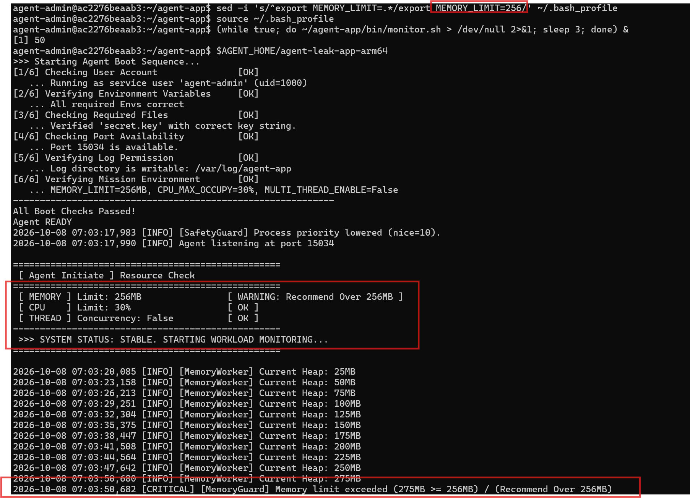
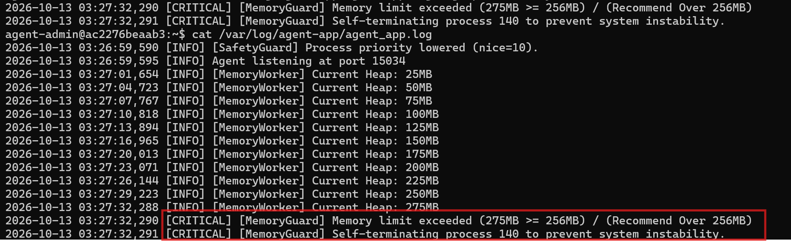

### After (`MEMORY_LIMIT=512`)
- **조치**: `~/.bash_profile`에서 `MEMORY_LIMIT`을 256MB에서 512MB로 상향 조정.
- **결과**:
  - 525MB 도달 시 비상 종료 대신 `Memory Cache Flushed` 로그와 함께 메모리를 즉각 비워냄 (`517MB → 188MB`).
  - 프로세스가 종료되지 않고 2분 이상 안정적으로 동작을 지속함.

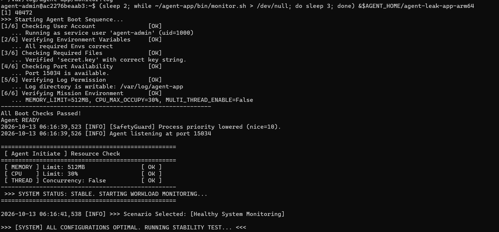
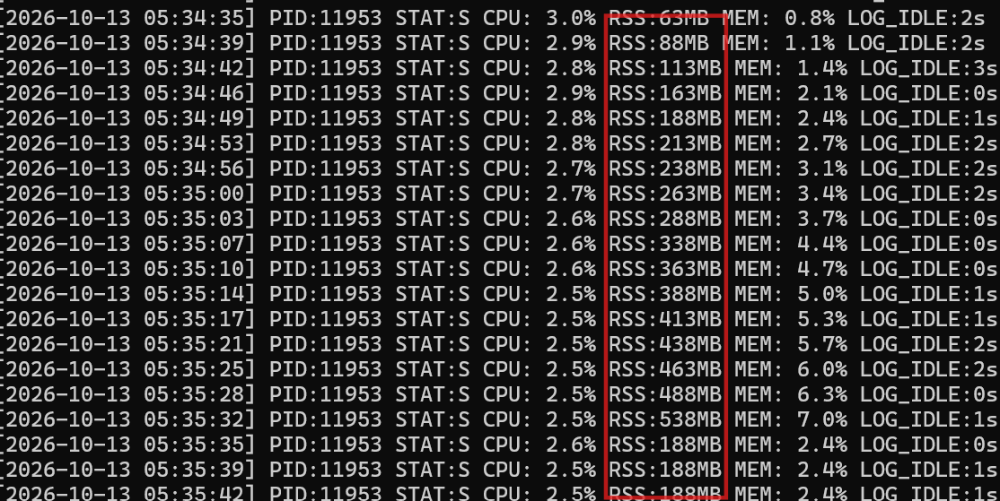

### 분석 및 근본 해결책
- **원인**: 힙(Heap)에 할당된 임시 데이터 및 컬렉션이 사용 후에도 적절히 해제(Eviction)되지 않는 메모리 누수.
- **근본 해결**: 환경 변수 상향은 종료를 일시 유예할 뿐이므로, 코드 레벨에서 캐시 만료 정책(TTL) 도입, 컬렉션 누수 지점 리팩토링 및 힙 덤프 기반 프로파일링 수행 필요.

---

## 2. CPU Threshold / Watchdog Emergency Abort

### Before (`CPU_MAX_OCCUPY=80` 또는 `100`)
- **현상**: 연산 부하가 증가하여 내부 Current Load가 50%를 초과하는 순간 `WATCHDOG: INITIATING EMERGENCY ABORT (SIGTERM)` 발생 후 비상 종료(`exit 143`, 생존 시간 약 34초).
- **핵심 로그 발췌**:
  ```text
  2026-10-08 07:25:10,102 [WARNING] [SafetyGuard] CPU Threshold Violated! Current Load: 54.14%
  2026-10-08 07:25:10,105 [CRITICAL] [Watchdog] WATCHDOG: INITIATING EMERGENCY ABORT (SIGTERM)
  >>> SYSTEM STATUS: EMERGENCY ABORT (CPU Limit Exceeded) <<<
  ```
- **관제 결과**:
  - `top`에서 측정되는 프로세스 CPU 점유율은 약 1.7%~2.0% 수준이나, 이는 3.1초 주기 중 0.1초 동안만 54% 부하가 순간 집중되기 때문임.
  - 시스템 유휴(idle) 상태는 96% 이상이었으나, 프로세스 내부 Watchdog 보호 기제가 발동하여 프로세스를 강제 종료시킴.

| CPU_MAX_OCCUPY | 최고 Load | 결과 | 생존 시간 | 종료 코드 |
| :--- | :--- | :--- | :--- | :--- |
| `100` | 50.75% | WATCHDOG SIGTERM | 24초 | 143 |
| `80` | 55.51% | WATCHDOG SIGTERM | 34초 | 143 |
| `30` | 30.00% | 정상 동작 (Cooldown 반복) | **1분 53초 이상** | - |

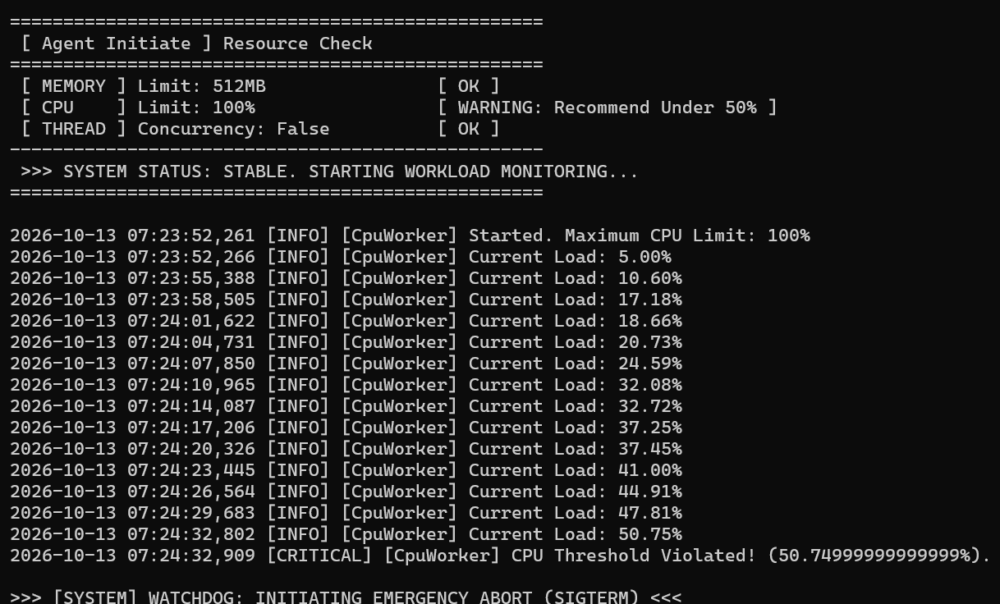
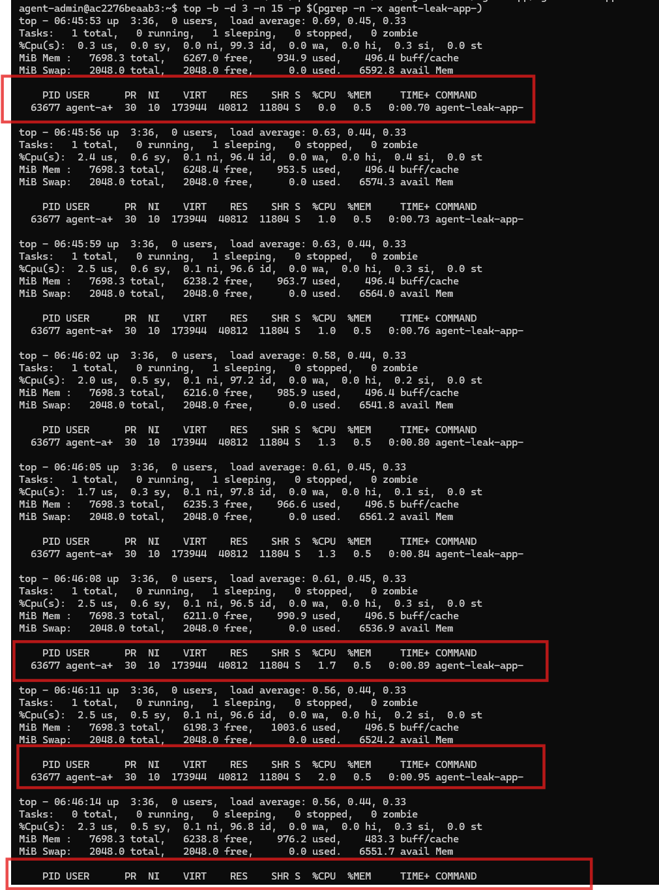

### After (`CPU_MAX_OCCUPY=30`)
- **조치**: `CPU_MAX_OCCUPY`를 30%로 하향 조정하여 쿨다운 임계치에 선제 진입 유도.
- **결과**:
  - 부하 30% 도달 시 `Peak reached`가 발생하며 `Cooldown` 모드로 자동 진입, 부하를 5%까지 식히는 과정을 반복함.
  - Watchdog에 의한 종료 없이 1분 53초 이상 중단 없는 안정적 운영 유지.

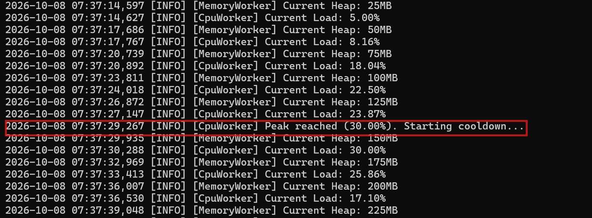
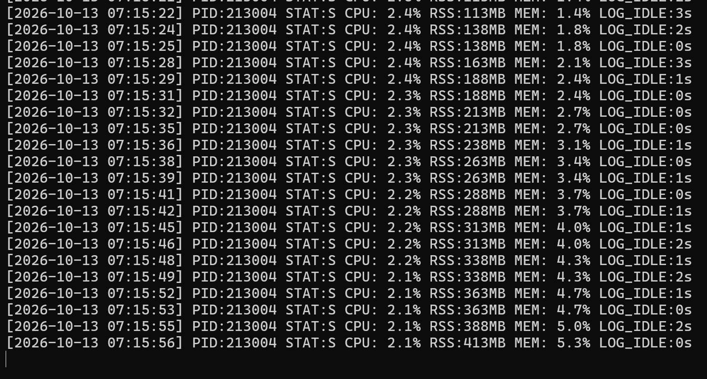

---

## 3. Deadlock / Resource Contention

### Before (`MULTI_THREAD_ENABLE=true`)
- **현상**: 프로세스 PID는 유지되나 CPU 사용률이 0.0%로 고정되고 신규 로그 출력이 완전히 중단되는 무응답(Hang) 발생.
- **핵심 증거**:
  - `ps -L` 및 `top -H` 확인 결과 모든 워커 스레드가 커널 락 대기 함수인 `futex_do_wait`에 갇혀 있음.
  - 관제 스크립트에서 CPU가 0.0%로 고정되고, `LOG_IDLE` 시간이 8s → 56s → 1000s+ 로 지속 급증.
- **원인 구조**:
  - 스레드 1: `Shared_Memory_A` 점유 후 `Socket_Pool_B` 대기
  - 스레드 2: `Socket_Pool_B` 점유 후 `Shared_Memory_A` 대기
  - 교착 상태의 4대 조건(상호 배제, 점유 대기, 비선점, **순환 대기**)이 모두 충족되어 영구적 동결 발생.

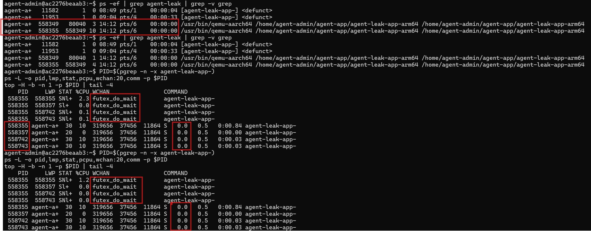
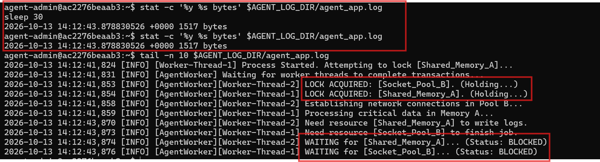

### After (`MULTI_THREAD_ENABLE=false`)
- **조치**: 프로세스 정리 후 `MULTI_THREAD_ENABLE`을 `false`로 변경하여 단일 스레드 순차 처리로 전환.
- **결과**:
  - 자원 경합 및 순환 대기 조건이 원천 차단됨.
  - 워커 스레드가 `futex_do_wait` 고착에서 벗어나 `poll_schedule_timeout` 및 정상 I/O 상태로 복귀.
  - CPU 사용률 0.9% ~ 1.3% 회복, `LOG_IDLE` 1초 미만 유지, 로그 파일 크기 정상 증가.

| 항목 | `MULTI_THREAD_ENABLE=true` (발생) | `MULTI_THREAD_ENABLE=false` (해소) |
| :--- | :--- | :--- |
| **로그 상태** | `WAITING ... BLOCKED` 이후 정지 | 타임스탬프와 함께 끊김 없이 계속 기록 |
| **스레드 상태** | 모든 스레드 `futex_do_wait` (락 대기) | `poll_schedule_timeout` 등 정상 폴링 |
| **CPU 점유율** | **0.0%** 완전 동결 | **0.9% ~ 1.3%** 정상 소모 |
| **LOG_IDLE** | 1000s 이상 지속 증가 | **0 ~ 1s** 정상 유지 |

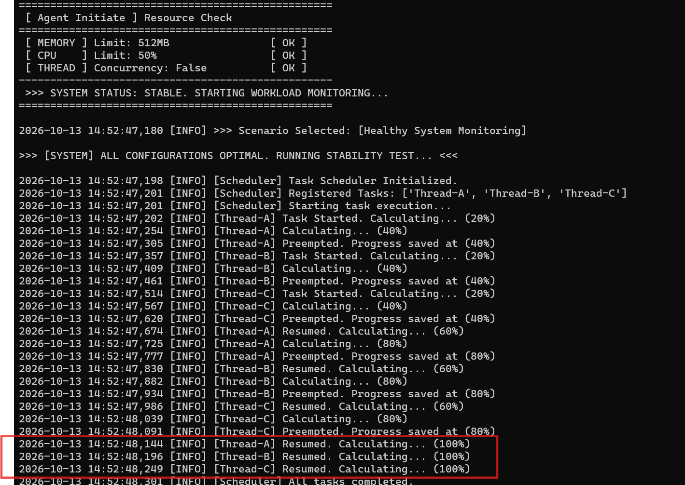
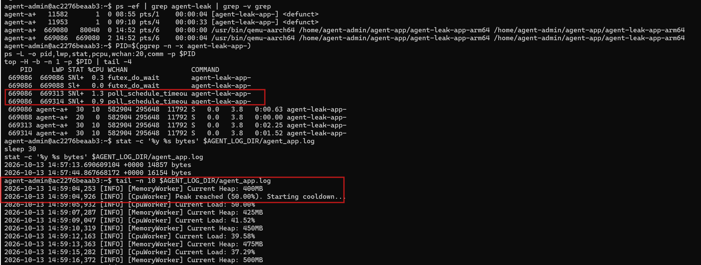

---

## 4. Scheduling Pattern Analysis

[`docs/scheduling.md`](./docs/scheduling.md)에서 `agent-leak-app` 정상 구동 시 수집된 워커 스레드 작업 로그의 타임스탬프와 진행률(Progress)을 분석하여 스케줄링 방식을 역추적하였습니다.

### 증거 로그 분석
```text
2026-10-15 04:29:56,179 [INFO] [Thread-A] Task Started. Calculating... (20%)
2026-10-15 04:29:56,231 [INFO] [Thread-A] Calculating... (40%)
2026-10-15 04:29:56,283 [INFO] [Thread-A] Preempted. Progress saved at (40%)
2026-10-15 04:29:56,335 [INFO] [Thread-B] Task Started. Calculating... (20%)
2026-10-15 04:29:56,388 [INFO] [Thread-B] Calculating... (40%)
2026-10-15 04:29:56,440 [INFO] [Thread-B] Preempted. Progress saved at (40%)
2026-10-15 04:29:56,493 [INFO] [Thread-C] Task Started. Calculating... (20%)
2026-10-15 04:29:56,547 [INFO] [Thread-C] Calculating... (40%)
2026-10-15 04:29:56,600 [INFO] [Thread-C] Preempted. Progress saved at (40%)
2026-10-15 04:29:56,653 [INFO] [Thread-A] Resumed. Calculating... (60%)
```

### 알고리즘 판정 근거
| 알고리즘 | 판정 | 판단 근거 |
| :--- | :---: | :--- |
| **Round-Robin (RR)** | **일치** | 각 스레드가 동일한 타임 슬라이스(약 40% 진행) 동안 실행된 후 강제 선점(`Preempted`)되며, A → B → C 순서로 교체 순환함 |
| **FCFS** | 불일치 | 먼저 실행된 Thread-A가 완료(100%)되기 전에 강제 중단되고 다른 스레드가 실행됨 |
| **Priority** | 불일치 | 특정 스레드의 우선 독점 없이 모든 스레드가 공평한 시간 할당량을 분배받음 |

- **결론**: 일정 타임 퀀텀마다 컨텍스트 스위칭이 발생하는 **선점형 라운드 로빈(Round-Robin)** 알고리즘이 적용되었음을 확인하였습니다.

---

## 배운 점 및 회고

1. **관제 지표의 다각화 중요성**:
   - 시스템 전체 CPU idle이나 메모리가 충분하더라도, 단일 프로세스의 내부 임계치나 순환 대기로 인해 서비스 장애가 발생할 수 있음을 확인했습니다.
   - 단순 시스템 리소스 외에 애플리케이션의 `LOG_IDLE` 시간, 스레드 단위의 커널 대기 함수(`wchan: futex_do_wait`)를 함께 관제하는 것이 결정적인 장애 단서가 됨을 체득했습니다.
2. **임시 조치와 근본 해결의 분리**:
   - `MEMORY_LIMIT` 상향이나 `CPU_MAX_OCCUPY` 조정은 당장의 프로세스 다운을 회피하는 워크어라운드(Workaround)일 뿐이며, 근본적으로는 소스 코드의 메모리 누수 해소와 락 획득 순서 정렬(예방)이 필수적임을 배웠습니다.
3. **OS 메커니즘의 실무적 체감**:
   - 책으로만 접했던 컨텍스트 스위칭, 선점 스케줄링(RR), 데드락 4대 조건을 실제 런타임 로그와 시스템 명령어로 교차 검증하며 운영체제 원리를 깊이 있게 이해할 수 있었습니다.