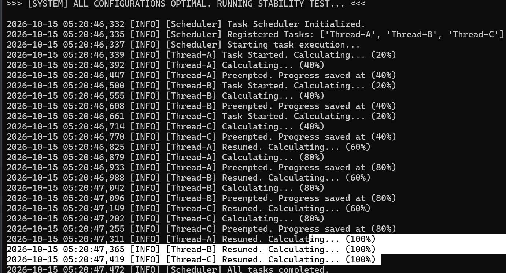
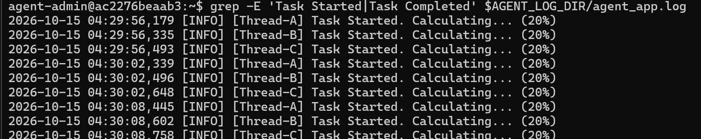

# [Analysis] 로그 패턴 분석을 통한 스케줄링 알고리즘 추론

## 0. CPU scheduler VS dispatcher


## 1. 로그 관찰 개요
`agent-leak-app`의 정상 실행 상태에서 발생하는 워커(Worker) 스레드들의 작업 로그를 수집하여, OS 또는 런타임이 작업을 처리하는 스케줄링 기법을 역추적했습니다.


## 2. 증거 자료
로그의 타임스탬프와 작업 진행률(Progress)을 분석한 결과, 하나의 작업이 완료되기 전에 다른 작업이 끼어드는 현상이 관측되었습니다.
```
[ Application Log Snapshot ]
2026-10-15 04:29:56,174 [INFO] [Scheduler] Task Scheduler Initialized.
2026-10-15 04:29:56,176 [INFO] [Scheduler] Registered Tasks: ['Thread-A', 'Thread-B', 'Thread-C']
2026-10-15 04:29:56,177 [INFO] [Scheduler] Starting task execution...
2026-10-15 04:29:56,179 [INFO] [Thread-A] Task Started. Calculating... (20%)
2026-10-15 04:29:56,231 [INFO] [Thread-A] Calculating... (40%)
2026-10-15 04:29:56,283 [INFO] [Thread-A] Preempted. Progress saved at (40%)
2026-10-15 04:29:56,335 [INFO] [Thread-B] Task Started. Calculating... (20%)
2026-10-15 04:29:56,388 [INFO] [Thread-B] Calculating... (40%)
2026-10-15 04:29:56,440 [INFO] [Thread-B] Preempted. Progress saved at (40%)
2026-10-15 04:29:56,493 [INFO] [Thread-C] Task Started. Calculating... (20%)
2026-10-15 04:29:56,547 [INFO] [Thread-C] Calculating... (40%)
2026-10-15 04:29:56,600 [INFO] [Thread-C] Preempted. Progress saved at (40%)
2026-10-15 04:29:56,653 [INFO] [Thread-A] Resumed. Calculating... (60%)
```



---




## 3. 각 알고리즘에 대한 개념
* **FCFS** : First-come , First-served : 먼저 도착한 순서대로 처리

* **Priority** : 우선순위가 높은 프로세스부터 실행

* **RR(Round-Robin)** : time slice로 나눠진 CPU time을 번갈아가면서 실행
    - 멀티 태스킹 방식과 가장 비슷한 스케줄링 방식


## 4. 패턴 분석 및 결론

* **순차 처리 아님**: Thread-A가 100% 완료되기 전에 Thread-B가 실행되었으므로, 먼저 온 작업을 끝까지 처리하는 방식이 아닙니다.
* **우선순위 아님**: 특정 스레드가 자원을 독점하거나 긴급하게 처리되는 경향 없이 A, B, C가 공평하게 나눠 가지는 모습을 보입니다.
* **최종 결론**: 각 스레드가 정해진 시간 할당량만큼 CPU를 사용하고, 자원을 반납하는 선점형 **라운드 로빈(Round-Robin)** 알고리즘으로 추론됩니다.

| 작업 | 등록순서 | 시작 | 완료 | 대기 | 반환 |
| --- | --- | --- | --- | --- | --- |
| **Thread-A** | 1 | ,339 | 1,311 | 648ms | 972ms |
| **Thread-B** | 2 | ,500 | 1,365 | 541ms | 865ms |
| **Thread-C** | 3 | ,661 | 1,419 | 434ms | 758ms |

*(※ 참고: '완료' 시간은 분이 넘어간 `47초` 대역이므로 `1,000ms`를 더하여 표기하였으며, '반환 시간'은 완료 시간에서 시작 시간을 뺀 값입니다.)*

## 5. 결과

| 방식 | 판단 | 근거 |
| --- | --- | --- |
| RR | **해당** | 정해진 할당량(40%씩)만큼 실행 후 강제 중단(`Preempted`)되며, A → B → C 순서로 교체되며 순환함 |
| FCFS | **아님** | 먼저 시작된 Thread-A가 100% 완료되기 전에 중단되고 다른 작업(B, C)이 실행됨 |
| Priority | **아님** | 특정 작업이 우선적으로 완료되지 않고, A, B, C가 동일한 시간씩 CPU를 공평하게 번갈아 할당받음 |

특정 작업이 CPU를 독점하지 않도록 타임 슬라이스 단위로 번갈아 실행하며 빠른 응답성을 제공하므로, 다수의 요청을 동시에 고르게 처리해야 하는 서비스인 웹 서버 및 API 서버에 적합합니다.