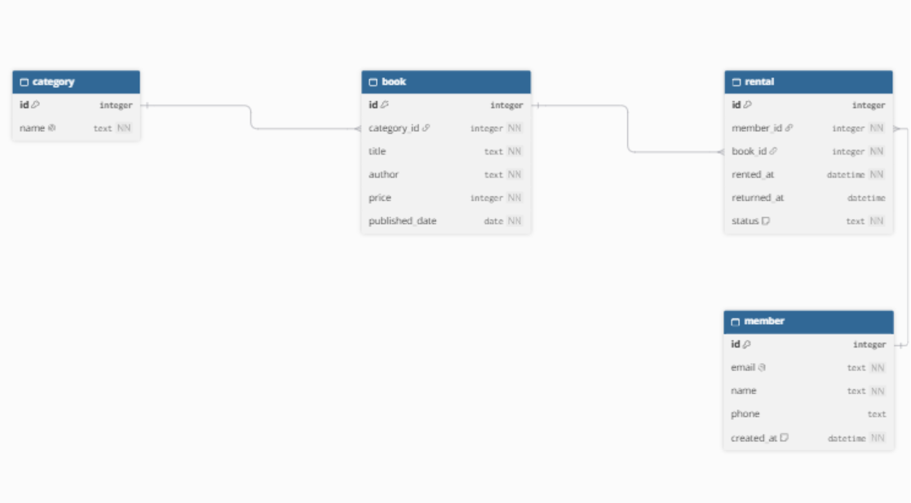

# 도서 대여 시스템 데이터베이스

백엔드 프레임워크 없이 **순수 SQL만으로** 데이터 모델링 → 데이터 입력 → 요구사항 쿼리 작성까지 진행한 실습입니다.

- **DB:** SQLite (파일 기반, 별도 서버 없음)
- **도구:** DBeaver
- **주제:** 도서 대여 (카테고리 · 회원 · 도서 · 대여 기록)

---

## 1. ERD



| 관계 | FK | 의미 |
|---|---|---|
| category 1 : N book | `book.category_id → category.id` | 한 카테고리에 여러 도서 |
| member 1 : N rental | `rental.member_id → member.id` | 한 회원이 여러 번 대여 |
| book 1 : N rental | `rental.book_id → book.id` | 한 도서가 여러 번 대여됨 |

> ERD 원본: [`erd.dbml`](erd.dbml) ([dbdiagram.io](https://dbdiagram.io)에 붙여 넣으면 다시 그려짐)

---

## 2. 테이블 설계

| 테이블 | 컬럼 | 제약조건 |
|---|---|---|
| **category** | id, name | PK, `name` NOT NULL · UNIQUE |
| **member** | id, email, name, phone, created_at | PK, `email` NOT NULL · UNIQUE, `created_at` 기본값 현재 시각 |
| **book** | id, category_id, title, author, price, published_date | PK, FK(category), `price` CHECK(≥ 0) |
| **rental** | id, member_id, book_id, rented_at, returned_at, status | PK, FK(member), FK(book), `status` CHECK(`'RENTED'`, `'RETURNED'`) |

- `returned_at`이 NULL이면 아직 반납하지 않은 대여입니다.
- SQLite는 FK 검사가 기본 OFF라서, 스크립트마다 `PRAGMA foreign_keys = ON;`으로 켭니다.

---

## 3. 실행 방법

아래 순서대로 실행합니다. `schema.sql`이 기존 테이블을 DROP하므로 언제든 처음부터 다시 만들 수 있습니다.

1. **[`schema.sql`](schema.sql)**: 테이블 생성
2. **[`data.sql`](data.sql)**: 샘플 데이터 입력 (부모 → 자식 순서, 테이블당 10행, **1회만** 실행)
3. **[`queries.sql`](queries.sql)**: 핵심 쿼리 15개
4. **[`bonus.sql`](bonus.sql)**: 보너스 과제 (문장 단위로 실행. B1~B4는 에러가 나야 정상)

DBeaver: **새 연결 → SQLite → Path에 `mission.db` 선택** 후, 각 파일을 **파일 → 파일 열기**로 열어 실행합니다.

---

## 4. 핵심 쿼리 15개

결과 캡처는 [`results/`](results) 폴더의 `Q01.png` ~ `Q15.png`에 있습니다.

| # | 분류 | 내용 | 사용 기술 |
|---|---|---|---|
| Q1 | 기본 조회 | 18,000원 이상 도서를 비싼 순으로 | WHERE, ORDER BY |
| Q2 | 기본 조회 | 아직 반납되지 않은 대여 기록 | IS NULL |
| Q3 | 기본 조회 | 가장 저렴한 도서 3권 | ORDER BY, LIMIT |
| Q4 | 기본 조회 | 2025년 2월 이후 가입 회원을 이름순으로 | WHERE, ORDER BY |
| Q5 | 조인 | 도서 + 카테고리 이름 | INNER JOIN |
| Q6 | 조인 | 누가 어떤 책을 언제 빌렸는지 | INNER JOIN (3개 테이블) |
| Q7 | 조인 | 전체 카테고리와 소속 도서 (도서 없는 카테고리 포함) | LEFT JOIN |
| Q8 | 조인 | 전체 회원과 대여 기록 (대여 이력 없는 회원 포함) | LEFT JOIN |
| Q9 | 집계 | 카테고리별 도서 수와 평균 가격 | COUNT, AVG, GROUP BY |
| Q10 | 집계 | 회원별 총 대여 횟수 | COUNT, GROUP BY |
| Q11 | 집계 | 대여 상태별 건수 | COUNT, GROUP BY |
| Q12 | 서브쿼리 | 전체 평균가보다 비싼 도서 | 스칼라 서브쿼리 |
| Q13 | 수정 | 1번 회원의 5번 도서 반납 처리 | UPDATE |
| Q14 | 삭제 | 대여 기록이 없는 9번 도서 삭제 | DELETE |
| Q15 | 인덱스 | `rental(member_id, status)` 복합 인덱스 | CREATE INDEX |

**인덱스 적용 이유:** "특정 회원의 대여 내역 / 대여 중인 도서" 조회(`WHERE member_id = ? AND status = ?`)와 member-rental JOIN이 자주 쓰이므로, 전체 스캔 대신 인덱스로 바로 찾기 위해 적용했습니다.
`EXPLAIN QUERY PLAN`으로 `SEARCH rental USING INDEX idx_rental_member_status`가 나오는 것을 확인했습니다. ([`results/Q15_explain.txt`](results/Q15_explain.txt))

---

## 5. 보너스 과제

### 보너스 1: 같은 요구를 JOIN과 서브쿼리로 풀기
**요구:** 대여 기록이 한 번도 없는 회원 찾기 (결과: 장도윤, 한지민)

| 방식 | 핵심 |
|---|---|
| LEFT JOIN + IS NULL | 짝이 없는 회원은 rental 쪽 컬럼이 NULL이 됨 |
| NOT IN | 대여한 회원 id 목록에 없는 회원 |
| NOT EXISTS | 이 회원의 대여 기록이 존재하지 않는 회원 (상관 서브쿼리) |

**비교 결과**
- 요구사항 문장과 가장 비슷하게 읽히는 건 서브쿼리 방식입니다.
- 두 테이블의 컬럼을 **함께 보여 줘야 하면 JOIN**, 조건으로 **걸러내기만 하면 서브쿼리**가 적합합니다.
- `NOT IN`은 서브쿼리 결과에 NULL이 하나라도 섞이면 에러 없이 0행을 반환합니다. (`SELECT 9 NOT IN (1, 2, NULL);` → `NULL`)
  이번에는 `rental.member_id`가 NOT NULL이라 문제가 없었지만, NULL 가능성이 있으면 `NOT EXISTS`가 안전합니다.

캡처: `bonus1_join.png`, `bonus1_not_in.png`, `bonus1_not_exists.png`, `NOT_IN근거.png`

### 보너스 2: 데이터 정합성 깨뜨려 보기

| # | 시도 | 결과 | 막힌 이유 |
|---|---|---|---|
| B1 | 없는 회원(999)으로 대여 기록 입력 | FOREIGN KEY constraint failed | 부모(member)에 없는 값 참조 |
| B2 | 없는 카테고리(99)로 도서 입력 | FOREIGN KEY constraint failed | 부모(category)에 없는 값 참조 |
| B3 | 대여 기록이 있는 1번 도서 삭제 | FOREIGN KEY constraint failed | 이 도서를 가리키는 rental 행이 남아 있음 (RETURNED 상태여도 막힘) |
| B4 | status에 오타 `'RETRUNED'` 입력 | CHECK constraint failed | 허용 값은 `'RENTED'`, `'RETURNED'`만 |
| B5 | FK를 끈 상태에서 들어간 고아 데이터 찾기 & 정리 | `PRAGMA foreign_key_check` 0행 | 자식(rental) → 부모(book) 순서로 삭제 |

**배운 점**
- FK는 상태값과 상관없이 **"가리키는 행이 있는지"만** 봅니다.
- 부모를 지우려면 그 부모를 가리키는 자식 행을 먼저 지워야 합니다.
- SQLite는 `PRAGMA foreign_keys = OFF`(기본값)이면 위 B1~B3이 **에러 없이 들어가 버립니다.** 실제로 실험 중 고아 데이터가 생겼고, B5로 찾아서 정리했습니다.

캡처: `B1_error.png` ~ `B4_error.png`, `B5_after.png` / 텍스트: [`results/bonus_fk.txt`](results/bonus_fk.txt)

### 보너스 3: 미니 리포트 (핵심 지표 3개)

| # | 지표 | 목적 | 결과 |
|---|---|---|---|
| 1 | 인기 도서 TOP 3 | 빌리려는 사람이 기다리지 않도록 인기 도서 추가 구매 | 1위: 혼자 공부하는 SQL (2회) |
| 2 | 카테고리별 대여 건수 | 사람들이 좋아하는 분야 파악 | 1위: 컴퓨터/IT (3건) |
| 3 | 연체 중인 회원 목록 | 반납 독촉으로 다른 회원이 책을 읽을 수 있게 | 정수진, 강지원, 운서야, 이영희 |

- **연체 정의:** `status = 'RENTED'`이면서 대여 후 7일 초과
- 날짜 차이는 `JULIANDAY('now') - JULIANDAY(rented_at)`로 계산 **[SQLite 전용]**

캡처: `report1.png` ~ `report3.png`

---

## 6. DB 전용 문법 정리

표준 SQL 범위로 작성했고, SQLite 전용 문법은 쿼리 옆에 주석으로 표시했습니다.

| SQLite | MySQL | PostgreSQL |
|---|---|---|
| `INTEGER PRIMARY KEY AUTOINCREMENT` | `AUTO_INCREMENT` | `SERIAL` / `IDENTITY` |
| `PRAGMA foreign_keys = ON` | 기본 ON (InnoDB) | 기본 ON |
| `DATETIME('now', 'localtime')` | `NOW()` | `CURRENT_TIMESTAMP` |
| `JULIANDAY(a) - JULIANDAY(b)` | `DATEDIFF(a, b)` | `a::date - b::date` |
| `EXPLAIN QUERY PLAN` | `EXPLAIN` | `EXPLAIN` |

---

## 7. 폴더 구조

```
6-1/
├── README.md
├── schema.sql        스키마 생성
├── data.sql          샘플 데이터
├── queries.sql       핵심 쿼리 15개
├── bonus.sql         보너스 1 · 2 · 3
├── erd.dbml          ERD 원본 (dbdiagram.io)
├── mission.db        SQLite DB 파일
└── results/          실행 결과 캡처 및 텍스트 (erd.png 포함)
```

---

## 8. 정리: 이 과제로 설명할 수 있게 된 것

- **엑셀과 DB의 차이:** 데이터를 테이블로 나눠 중복을 없애고, **FK로 관계를 표현**하며, 제약조건으로 잘못된 데이터를 DB가 직접 막습니다.
- **PK / FK:** PK는 테이블 안에서 각 행을 구별하는 "내 번호", FK는 다른 테이블의 PK를 적어 두는 "남의 번호"입니다. 이 연결을 따라가는 것이 JOIN입니다.
- **INNER JOIN vs LEFT JOIN:** INNER는 짝이 있는 행만, LEFT는 왼쪽 테이블의 모든 행을 남기고 짝이 없으면 NULL로 채웁니다. (Q6과 Q8 비교)
- **GROUP BY:** "~별로" 묶어서 COUNT / AVG로 집계합니다.
- **인덱스:** 자주 검색·조인하는 컬럼에 만들어 전체 스캔을 피합니다.
